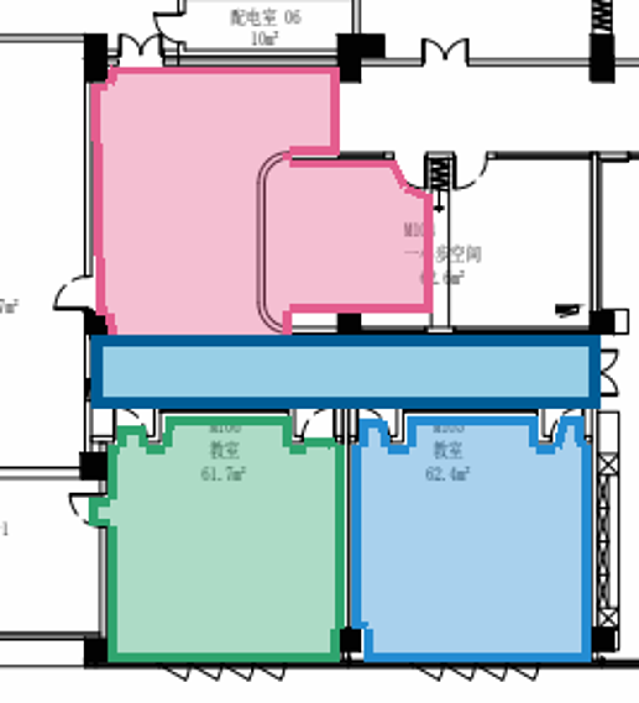
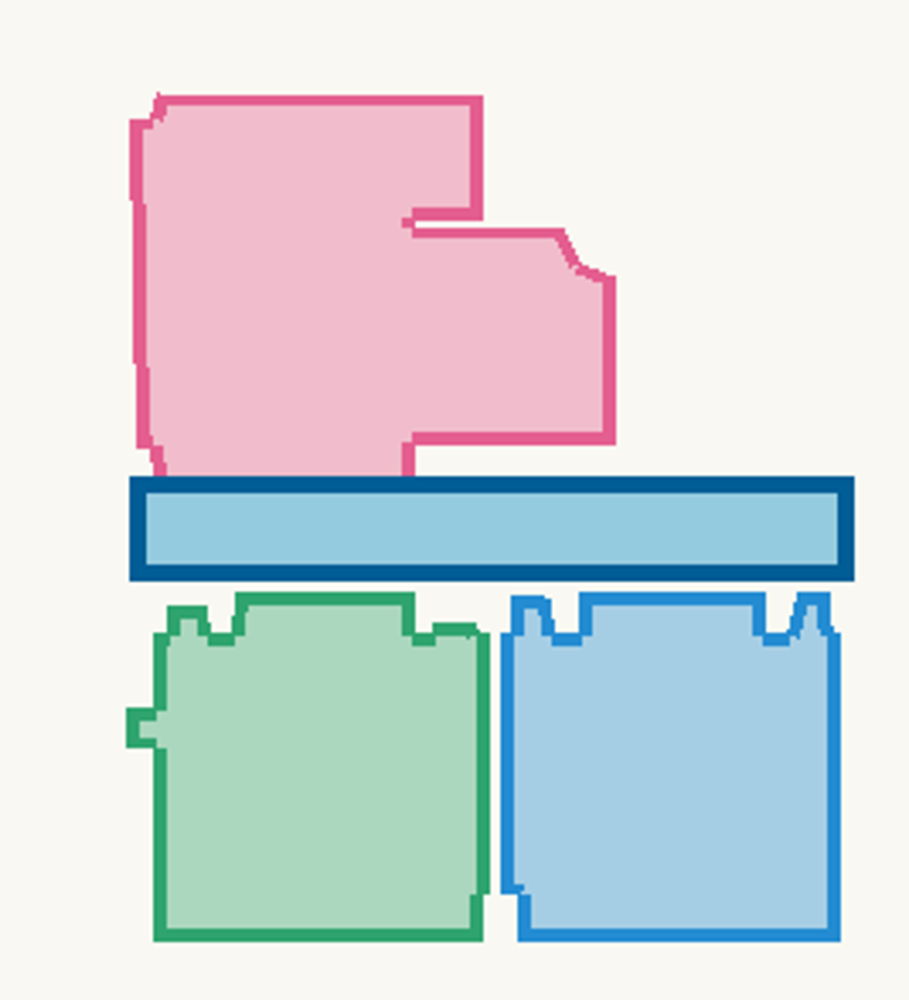
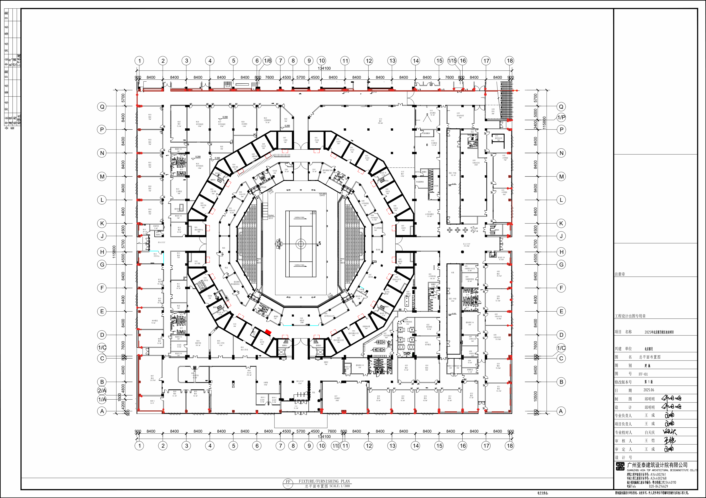
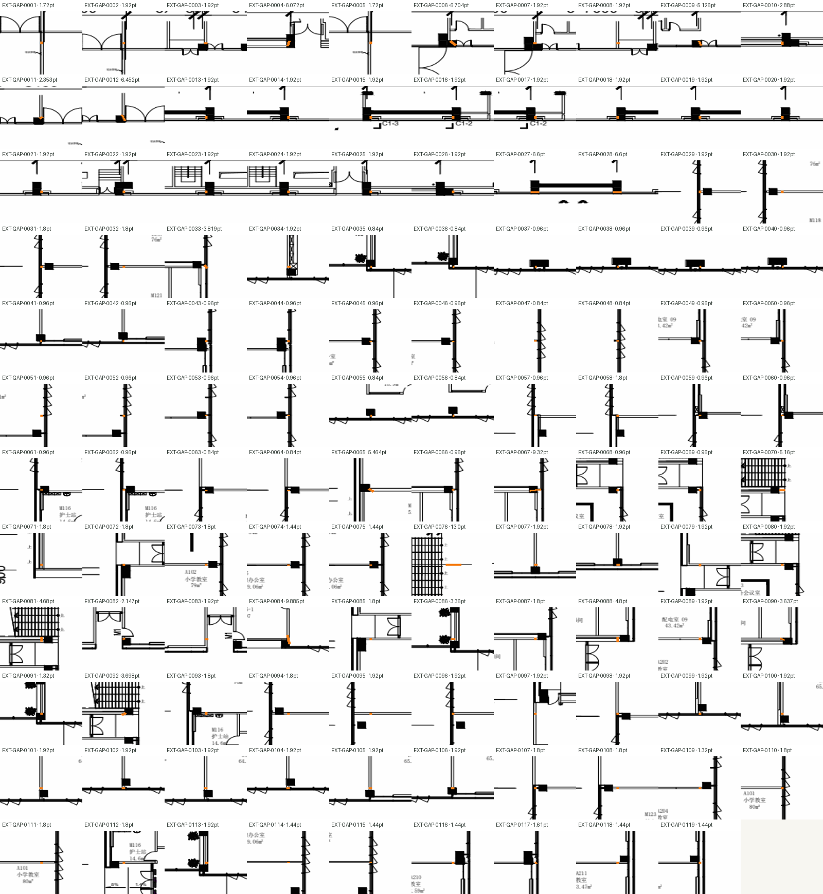
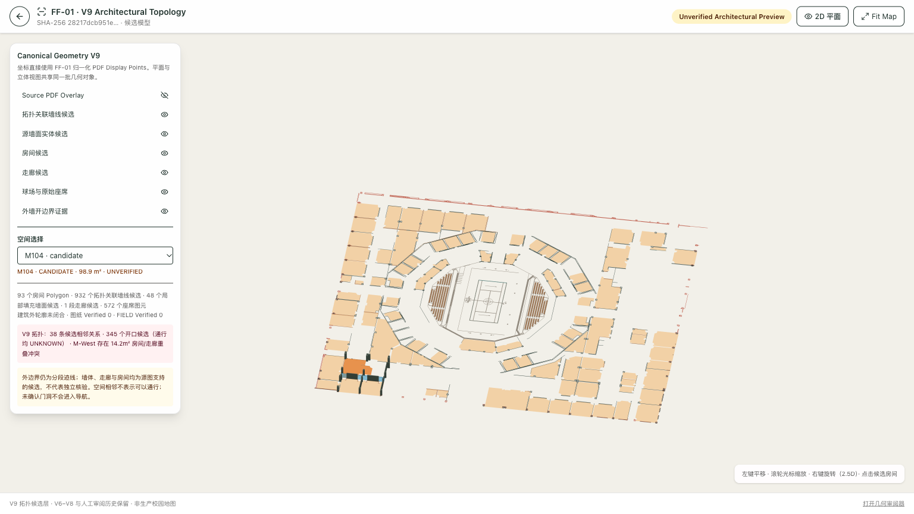
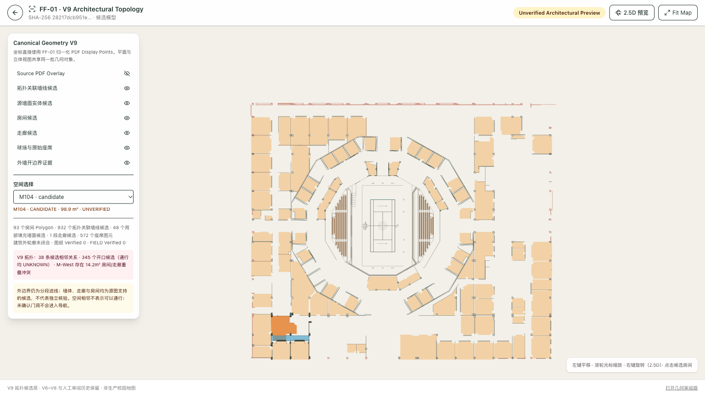
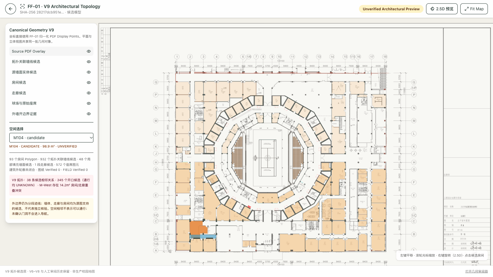
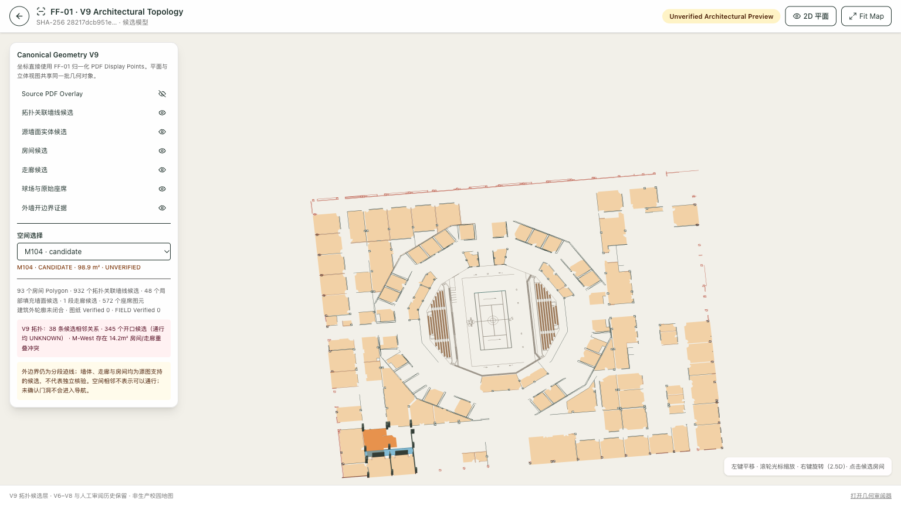
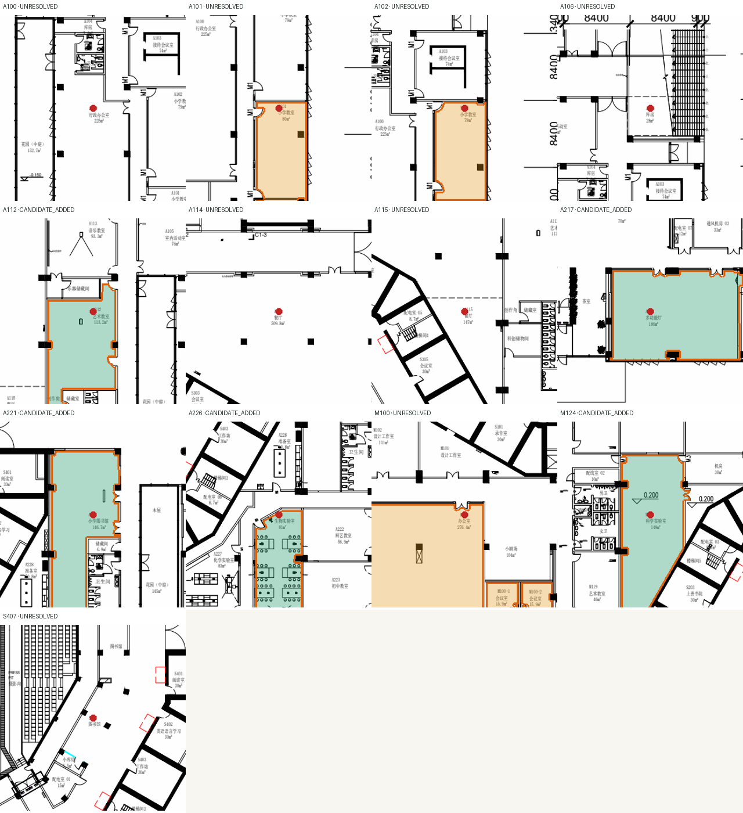

# FF-01 Architectural Topology V9

## Status

V9 adds a source-linked topology candidate layer alongside the immutable V6/V7/V8 evidence models. It improves the relationship between room-boundary evidence and source wall paths, records area-text ambiguity, and reports spatial conflicts. It is not a Drawing-Verified building model.

| Gate | Result | Evidence |
|---|---|---|
| Data integrity | PASS | Source PDF hash matches V6, V7, V8, V9, and the vector cache; source path references resolve; no verification records were fabricated. |
| Geometry construction | PARTIAL | 93 of 101 label occurrences have candidate polygons; the outer footprint remains open. |
| Topology consistency | PARTIAL | Candidate shared-wall and adjacency references exist; one M104/corridor overlap remains unresolved. |
| Source alignment | PARTIAL | Candidate edges cite native wall, door, glazing, or unsupported evidence; no geometry is independently Drawing-Matched. |
| Drawing verification | PENDING | No real reviewer decisions have been added. |

Source PDF SHA-256: `28217dcb951ea45b34d2651851f36bcd0af5824d27b5d588b60cdf3672ce3d60`.

## Candidate coverage

- 101 source label occurrences; 98 unique base room codes.
- 88 V8 room candidates were retained unchanged as source candidates.
- Five additional V9 candidates were recovered: A112, A217, A221, A226, M124.
- 93 room polygons exist in V9; eight of the 13 previously missing labels remain without a production candidate: A100, A101, A102, A106, A114, A115, M100, S407.
- M/S/A candidate coverage is 31/32, 31/32, and 31/37 labels respectively.
- Candidate polygons are unverified. They must not be used as navigation truth.

The five added polygons were accepted only after seed containment, polygon validity, bounded-area screening, the existing V8 candidate screen, and overlap checks. The V9 edge audit separately reports wall-face support, door, glazing, and unsupported lengths; those metrics remain review evidence and are not a claim that the polygons follow verified interior wall faces. Rejected regional proposals are retained in `canonical-architecture-v9.json` under `remaining13Recovery.results` with candidate geometry and source P-IDs where a contour could be formed.

## Boundary evidence

Each room edge records its source path IDs, evidence category, nearest compatible wall distance, supported boundary length, side-consistency result, and review status. Semantic categories are kept separate:

- `PHYSICAL_WALL_BOUNDARY_CANDIDATE`
- `DOOR_OPENING_CANDIDATE`
- `GLAZING_BOUNDARY_CANDIDATE`
- `UNSUPPORTED_INFERRED_BOUNDARY`

Wall provenance is more selective than the V8 proximity flag: a wall path is linked as edge support only when its buffered geometry covers a measurable portion of that edge. Door leaves and glazing are not promoted to physical walls. This is still candidate evidence, not proof that the line is the room's interior wall face.

## M-West topology sample

The sample includes M104, M105, M106, and `FF01-CORRIDOR-M-WEST-01`. Shared-source wall candidates yield proposed adjacency relations for M104/M106, M105/M106, M105/corridor, and M106/corridor. Passability remains `UNKNOWN` for all such relations.

The V8 M104 candidate overlaps the corridor candidate by **1,271.281 PDF pt² (14.239 m²)**. V9 represents this as `SPATIAL_CONFLICT`, not adjacency. It is visible in the overlay and blocks a claim that this four-object region is topologically coherent. No automatic clipping or area-based shrinking was applied.





## Area text

Area annotations are diagnostic only and never alter a polygon. The extractor stores raw local text, each token bounding box, candidate numeric parses, candidate room associations, confidence, and ambiguity state. Tokens that are split or adjacent to multiple labels are not treated as authoritative dimensions. This addresses fragmented labels such as A210 and A207 without guessing a room assignment. The current extraction reports 47 high-confidence area candidates, 47 ambiguous area associations, and 7 labels without a usable area candidate; see the generated V9 report for the exact state after each rebuild.

## Exterior boundary

V9 analyzes 1,746 existing exterior-trace candidate segments into connected chains and nearby gap pairs. Gap pairs are review targets only; the graph does not close them. The longest or largest enclosure is not assumed to be the building footprint. At present the footprint remains `geometry: null`, with open endpoints and ambiguous junctions retained in the model.



The 119 nearest endpoint pairs are available as a review contact sheet:



## Browser preview evidence

The development-only route is `/dev/building-preview-v9`. It loads `public/ff01-architecture-v9.json`, exposes source overlay and geometry layers, and reuses the existing orthographic MapControls. These screenshots were taken from the running Vite app at 1536×864; they document rendering and interaction, not building accuracy.









## Lotus Arena

V9 preserves two source court-boundary candidates and six seat-footprint clusters accounting for 572 seat outlines. It does not yet claim stand-deck polygons, continuous inner/outer architectural rings, ring-corridor geometry, or access points. Seating elevations remain illustrative and do not change plan coordinates.

## Remaining room review

The 13 previously missing rooms were individually retried with a 150 pt regional context rather than the default local seed. Five candidates passed screening. The others are unresolved for these reasons:

| Room | Result | Reason |
|---|---|---|
| A100 | UNRESOLVED | No bounded seed-connected component at expanded context. |
| A101 | UNRESOLVED | Candidate retained for review; wall support 0.570, below screening threshold. |
| A102 | UNRESOLVED | Candidate retained for review; wall support 0.587, below screening threshold. |
| A106 | UNRESOLVED | No bounded seed-connected component at expanded context. |
| A114 | UNRESOLVED | No bounded seed-connected component at expanded context; area text itself is ambiguous. |
| A115 | UNRESOLVED | No bounded seed-connected component at expanded context. |
| M100 | UNRESOLVED | Candidate conflicts with existing M100-1/M100-2 polygons; not merged or reshaped. |
| S407 | UNRESOLVED | No bounded seed-connected component at expanded context. |

All 13 local source crops and candidate proposals are generated under `output/architecture-v9/remaining13-*`.



## Rebuild and validation

```sh
npm run rebuild:architecture-v9
npm run validate:architecture-v9
```

The builder writes `data/source/canonical-architecture-v9.json`, its report, and `public/ff01-architecture-v9.json`. The validator writes a separate validation report. V6/V7/V8 files and the geometry-review history are not modified by the V9 builder.
