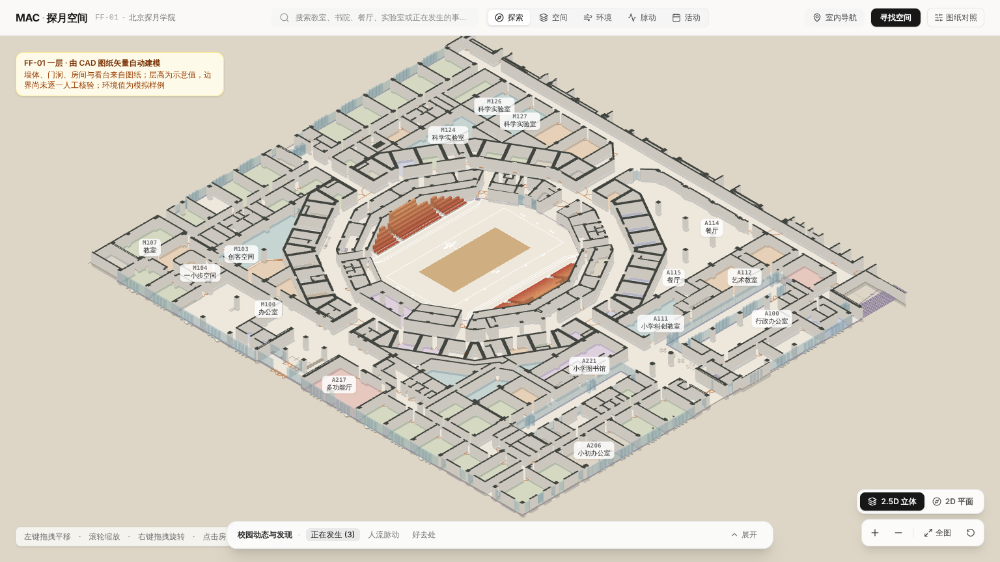
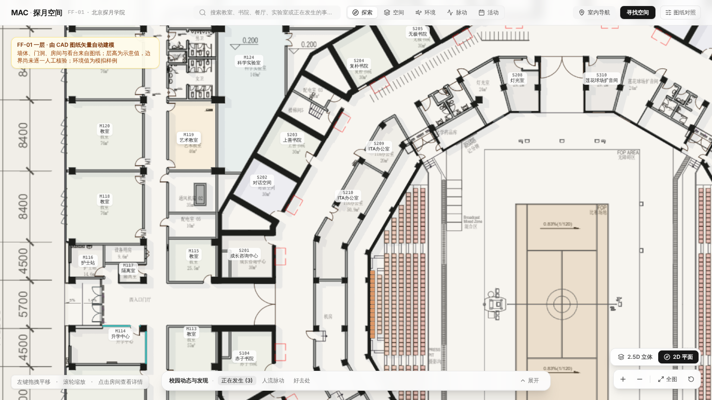
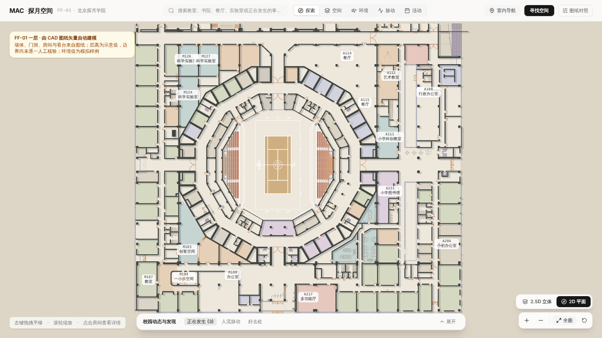
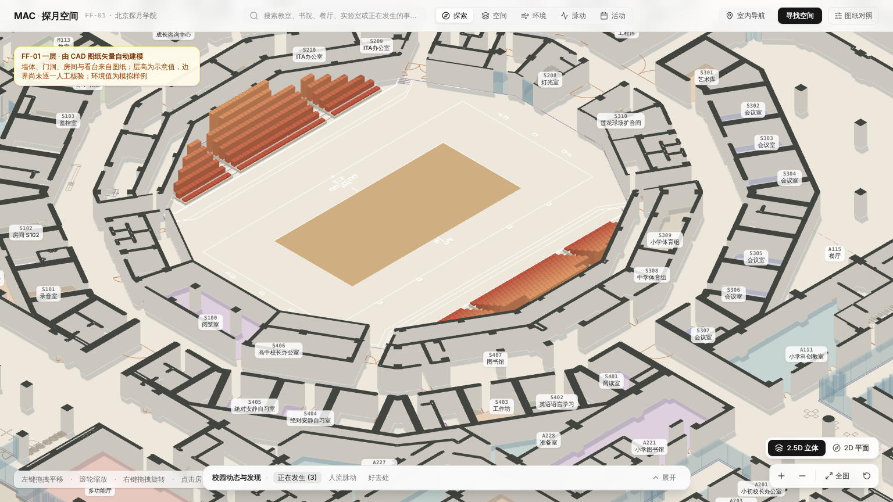
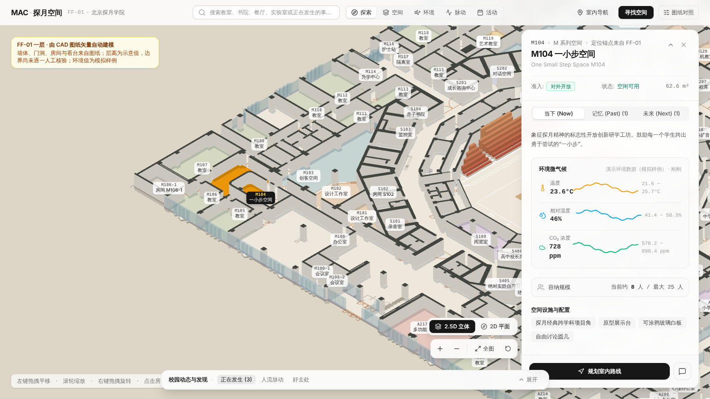

# FF-01 3D Campus Model

The main campus map (`/`) renders a 3D model generated directly from the FF-01 drawing. It replaces the earlier "source sheet only" map. The model is **source-derived and unverified**: every wall, room, seat and floor line traces back to FF-01 vectors or V9 candidates, but no geometry has been DRAWING_VERIFIED, and heights are illustrative.



## What is modelled, and from where

| Element | Source | Method | Count |
|---|---|---|---|
| Walls | CAD layers `A05-建筑原有墙体`, `A07-新建隔墙`, `T-*$0$wall(-thin)`, columns; filled shear walls from V9 `wallFaceCandidates` | Line paths buffered 1.05 pt per side (merges double-line walls ≤ 0.22 m apart), unioned with filled faces, extruded 2.8 m. Door openings stay open where the CAD wall lines break. | 159 bodies from 3,722 source paths |
| Glazing | `T-CC+C1-0.00$0$GLAZ`, `玻璃隔断`, `WINDOW`, `P04-窗户` | Buffered 0.45 pt, minus walls, rendered as glass | 182 bodies |
| Rooms | Wall, glazing and door vectors (`scripts/room_regions.py`) | Region grown from each label inside the walls; see *Room regions* below | 102 coded rooms (100 with a region) + 63 named spaces |
| Room labels and names | Room-ID text blocks in the PDF (PyMuPDF, rotation-normalised) | Name = the CJK line in the same label block (or fused, e.g. `M109教室`); area = the m² line | 102 labels; plus uncoded spaces (卫生间, 楼梯间, 机房, 小剧场 …) |
| Lotus Arena | V9 court-boundary and seat-footprint candidates | Court surface; each seat extruded by row (row = distance from the court edge ÷ 7.6 pt) | 572 seats, 8 rows |
| Floor detail | Furniture, equipment, door leaves and swings, stairs, court markings | Flat lines at floor level | ~65k segments |
| Slab / footprint | Wall ∪ glazing union | Morphological closing (28 pt), largest exterior ring | 15,616 m² (1.006 × the 134.1 × 115.8 m dimension-chain rectangle) |

The coordinate frame is metres, origin at the FF-01 grid centre, x east, z south, 1 pt = 0.10583 m (the existing V6 1:300 calibration). It coincides with `planToWorld()`, so existing space centres, search focus and the camera controller work unchanged.

## Room regions

Earlier builds reused the V9 room candidates, which split some rooms (M104 was cut in half by a folding partition) and left others as corridor. Regions are now derived in `scripts/room_regions.py`:

1. **Barriers.** Buffered wall lines and filled wall faces, plus glazing, door leaves and swing arcs (≤ 12 pt). Longer runs on the door layer are folding partitions ("tracks").
2. **Variants.** Four barrier sets (`glass+tracks`, `glass`, `tracks`, `walls+doors`) × door-gap closing at 0, 4.5, 6, 7.5 and 9 pt.
3. **Choice.** For each label, the face containing it is chosen. A face that swallows another room's label is avoided first. Then the face whose area is closest to the printed m² wins.
4. **Shared faces.** When several labels still fall in one face (e.g. A114 / A115), the face is split in proportion to their printed areas along its long axis.
5. **Closures.**
   - A106 is bounded by a dashed line on FF-01.
   - 小剧场 (above M100-1) is a reviewer-defined closure: there is no wall on its open side.
6. **Uncoded spaces.** Rooms named on the sheet without a code (卫生间, 楼梯间, 机房, 配电室, 中庭花园 …) get regions too. They are kept only when the result is plausible: inside 35% of a printed area, not overlapping a coded room, and not a duplicate.
7. **Corridors.** Everything not claimed stays corridor. The V9 corridor polygons are no longer drawn.

Each room records `regionMethod` and `geometryStatus`: `WALL_ENCLOSED_CANDIDATE`, `SHARED_SPACE_SPLIT_CANDIDATE`, `DASHED_BOUNDARY_CANDIDATE`, `REVIEWER_DEFINED_CLOSURE` or `NO_POLYGON_LABEL_ONLY`.

## Verification evidence

The source drawing can be overlaid on the model (图纸对照 → 叠加 FF-01 原始图纸). Walls, seats, court lines and door swings coincide with the PDF raster:









`npm run validate:campus-3d` checks:
- the PDF hash,
- every V9 label is present, IDs are unique, and coded rooms keep their printed code,
- at least 99 coded rooms have a region,
- regions do not overlap each other or cross walls,
- region area is within 35% of the printed area (a few checked exceptions),
- M104 covers the whole rounded room, and 小剧场 has a region,
- polygon validity,
- label-in-room containment,
- footprint span and area against the printed dimension chains,
- walls and rooms inside the footprint,
- the seat count,
- line-layer decoding,
- `src/data/sourceRooms.ts` parity.

## Known limits

- **Heights**: 2.8 m walls (same as V9 `illustrative3D.wallHeightM`); seat rise 0.38 m per row. There is no section drawing.
- **Room boundaries**: derived, all UNVERIFIED.
  - S407 (the open library ring) and the open spaces (入口门厅 ×3, 创新区, 茶室) have no drawn boundary. They are label-only: selectable through search, not by clicking.
  - Region area differs from the printed area by more than 35% for M102, M117, M128, S100, S208 and S308. Each was checked against the drawing: the printed figure includes walls or adjoining space.
  - A few small service rooms are not detected (通风机房02, 配电室07/09, 储藏间, 小库房, 门斗, 化学药品库).
- **Names**: A209's name is a low-confidence nearby-text match. M106-1 and S102 have no name text on the sheet.
- **Footprint**: derived, not traced. Entrance recesses narrower than ~5.9 m are bridged.
- **Arena**: no ring-corridor polygon and no access openings. Stand height is illustrative.
- **Navigation**: routes run on a walking grid derived from this model ([`NAVIGATION.md`](NAVIGATION.md)). The wall model shows openings but does not establish passability; rebuild the grid after rebuilding the model.
- **Rooms without product content**: rooms not described in `floorplanData.ts` get a drawing-only entry (name and area). They show no sensor, occupancy or event data, and none is invented.

## Rebuild

```sh
python3 -m pip install -r scripts/requirements-spatial.txt
npm run rebuild:campus-3d -- --pdf "/path/to/01_探月26年平面系统图（根据最新导视图更新）20260806-.pdf"
npm run validate:campus-3d
```

Without `--pdf`, the builder uses the path recorded in `data/source/spatial-extraction-summary.json`. It refuses to run if the PDF hash differs. Outputs:
- `src/generated/ff01-campus-core.json`: walls, rooms, arena. About 50 KB over the wire (Brotli); fetched at start-up.
- `src/generated/ff01-campus-detail.json`: furniture, door, stair and court lines as delta-encoded centimetre polylines. About 95 KB over the wire; fetched once the browser is idle after the first frame.

Both are emitted by Vite with content hashes under `/assets/`, so they are cached for a year.
- `src/data/sourceRooms.ts`

## Code map

- `scripts/build_campus_3d.py`: the builder.
- `scripts/room_regions.py`: room and named-space regions from wall, glazing and door vectors.
- `scripts/validate_campus_3d.py`: the validator.
- `src/components/canvas/campusModel3d.ts`: model types, loading, Three.js scene construction (walls with dark caps and light sides, glass, rooms, arena, floor lines), highlight and recolour API.
- `src/components/canvas/CampusCanvas.tsx`: renderer, lighting and shadows (computed once), CSS2D room labels by zoom level, picking, layer colouring, on-demand rendering, view controls.
- `src/components/canvas/cameraController.ts`: direct-manipulation camera.
  - Drag keeps the point under the finger fixed, then glides after a fling. Release velocity uses event timestamps.
  - A mouse wheel eases toward the cursor. A trackpad pinch zooms 1:1, and a two-finger trackpad scroll pans.
  - Touch: pinch zooms and pans together, and a two-finger twist rotates.
  - Right-drag or ⌘/Ctrl-drag rotates and tilts in 2.5D, with glide.
  - Fly-to animations ease out, use a duration based on distance (320–700 ms), interpolate zoom in log space, and can be interrupted. Selecting a room never zooms out.
  - Also: `setFitBounds` and `targetViewMode`. An interrupted 2D/2.5D switch completes its tilt.
- `src/data/floorplanData.ts`: appends drawing-only spaces for every FF-01 label not covered by product content.

## Performance

| | Before | After |
|---|---|---|
| Downloaded on first visit (live site, 9 Mbit/s + 150 ms latency, headless Chromium) | 1,129 KB | 507 KB |
| First paint | 1.6–3.0 s | 0.9–1.0 s (startup screen drawn from HTML) |
| Map interactive | 4.8–5.0 s | 4.4–5.3 s (measured with software WebGL; scene building dominates) |
| Model data at start-up | 384 KB (one file, no long cache) | ~50 KB core; detail follows when idle |
| FF-01 drawing texture | 296 KB at every start-up | only when 对照原图 is opened |
| Logo | 62 KB PNG | 7 KB WebP |
| JavaScript | one 978 KB file, 4 h cache | app shell, three.js and map code in separate files, cached for a year |
| Rendering when nothing moves | animation loop running | loop sleeps (0 frames) |

Other changes:
- A startup screen is drawn from HTML, before any JavaScript runs. The name "Moonshot Academy Campus" fades in once the display font is ready (or after 450 ms). It stays at least 900 ms so a fast load doesn't just flash it. The first 3D frame is rendered underneath it; the map then tilts in as the screen fades. Every animation on it is opacity or transform, so it stays smooth while the main thread loads the map.
- Fonts are self-hosted under `/fonts/` and preloaded: Hanken Grotesk (variable, 35 KB) and an Unbounded subset (Latin letters and digits, 8 KB). They no longer come from Google Fonts, which is unreachable in mainland China and failed in some browsers, leaving the site in system fonts.
- The pixel ratio stays constant. Lowering it while moving reallocated the canvas and caused a visible hitch.
- Sensor polling pauses in background tabs.
- Dev-only preview pages are left out of production builds.

### Interaction frame rate (October 2026)

Measured on a MacBook Air (Apple silicon, Retina, 1536 × 900 viewport, canvas 3072 × 1800) with about 80 room labels on screen. The map was driven by scripted pointer and wheel input; numbers are frames per second.

| | Pan | Rotate | Wheel zoom | Hover |
|---|---|---|---|---|
| Before | 23.7 | 20.5 | 17.0 | 32.5 |
| After | 60 | 60 | 60 | 60 |

What changed:
- **Room labels no longer use `backdrop-filter`.** Re-blurring ~80 chips over a WebGL canvas that changes every frame cost two to three frame budgets. This was the main cause; turning off only this restored 60 fps for pan and rotate.
- **Labels are positioned by the map code, not `CSS2DRenderer`.**
  - Each chip is its own compositor layer, moved with `translate3d` and shown or hidden with `visibility`.
  - Only changed values are written, and nothing is re-sorted or re-laid-out per frame.
  - Chip sizes are measured once, in one batch, and again after web fonts load.
  - This fixed the remaining zoom stutter, which came from labels appearing and disappearing.
- **Compass and scale bar** are written straight to the DOM instead of through React state on every frame.
- **Hover picking** runs at most once per frame. The canvas rectangle is cached, so pointer moves never force a layout.
- **Adaptive resolution.** If more than 60% of 45 moving frames take longer than 24 ms, the pixel ratio steps down once (2 → 1.5 → 1.25 → 1) and stays there for the session. It is never toggled per gesture, which would reallocate the canvas.
