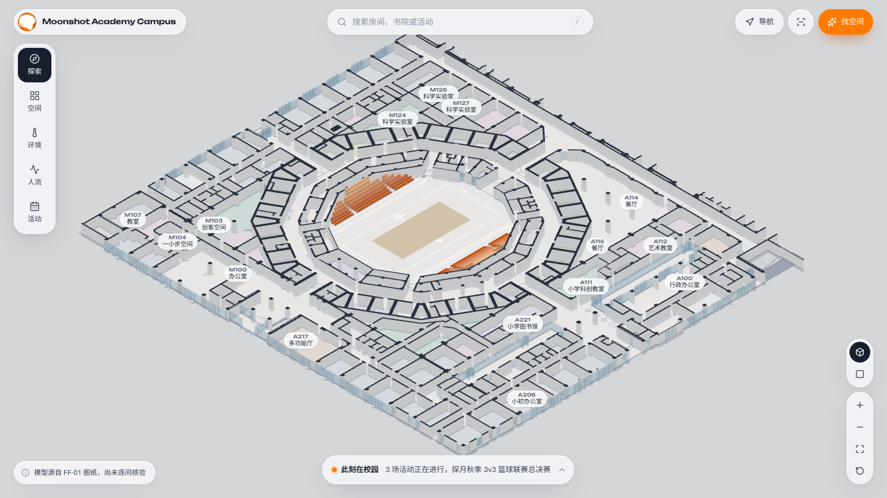
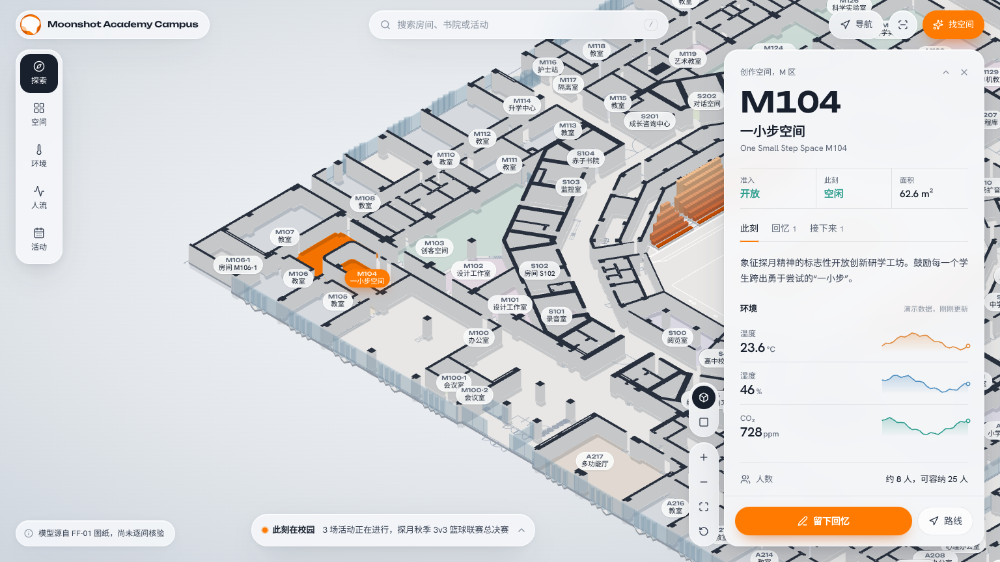
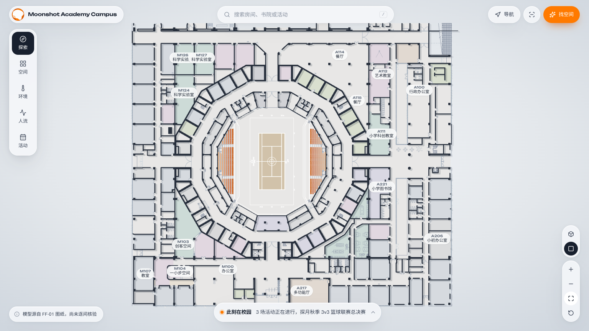
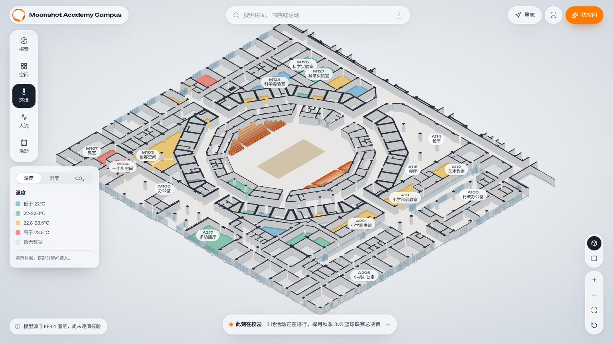
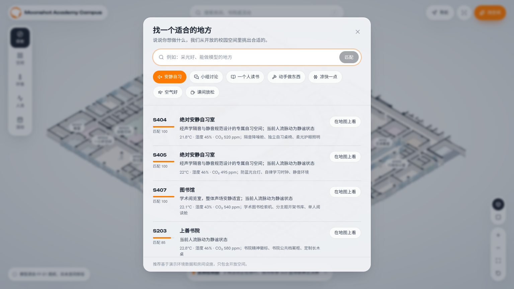
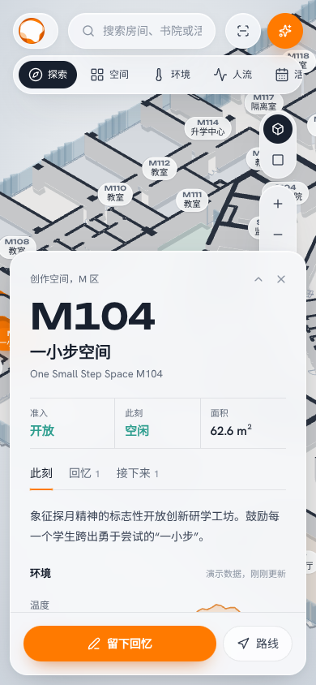

# Moonshot Academy Campus: interface design

## Concept

The logo is a set of translucent orange orbits overlapping a white disc, and the building itself is a ring of rooms around the Lotus Arena. The interface takes those two cues:
- a cool, moon-dust light base with deep blue-ink text and wall caps;
- the logo's three oranges reserved for things that are alive: the selected room, live activities, the arena seating, and the one primary action in each view.



## Tokens (`src/index.css`, Tailwind v4 `@theme`)

| Token | Value | Use |
|---|---|---|
| `ink` | `#18202e` | Text, wall caps, selected controls |
| `ink-soft` / `crater` / `dust` | `#364052` / `#5e6878` / `#8a93a1` | Secondary text, captions, icons |
| `haze` / `regolith` / `lunar` | `#c9cfd7` / `#e3e7eb` / `#f5f6f8` | Rules, page base, dialog surface |
| `flare` | `#ff7a00` | Selection, live, primary action |
| `ember` | `#d35400` | Hover on primary, live text, front seat rows |
| `glow` / `flare-wash` | `#fdcb9c` / `#fff3e8` | Back seat rows, upcoming, live callouts |
| `calm` / `alert` | `#2f9e8f` / `#d9485f` | Open / free, crowded |

**Type.** Unbounded (wide geometric) is used only for the wordmark and room codes, so a room number is the headline of its own page. Hanken Grotesk, falling back to PingFang SC / Noto Sans SC, is used for everything else. There are no all-caps eyebrows and no monospace labels.

**Shape hierarchy.** Controls are capsules. Floating sheets use a 22 px radius. Inner tiles use 14 px. Lists are separated by hairlines rather than boxed into cards.

**Surface.** `.glass` is a frosted layer with a faint lit top edge and an ink-tinted shadow. It is used only for things that float over the map.

**Motion.** The orbit logo turns while the 3D model is generated, and the camera flies into 2.5D once it is ready. Beyond that, motion only answers actions (sheets sliding in, tabs, toggles). Everything respects `prefers-reduced-motion`.

## Layout

```
 ( logo  Moonshot Academy Campus )   ( ⌕ 搜索房间、书院或活动  / )   ( 导航 ) (⌗) ( ✦ 找空间 )
 ┌──┐                                                                   ┌──────────────┐
 │探索│  legend                      3D campus map                        │ M104         │
 │空间│  (for the active layer)                                           │ 一小步空间     │
 │环境│                                                                   │ 准入 此刻 面积 │
 │人流│                                                                   │ 此刻 回忆 接下来│
 │活动│                                                                   │ …            │
 └──┘                                                         [▣][□]   │ [留下回忆][路线]│
 ( ⓘ 模型源自 FF-01 图纸 )          ( ● 此刻在校园  3 场活动正在进行… ^ )    [+ − ⤢ ↺]  └──────────────┘
```

- **Top bar:** three floating capsules. Search matches rooms by code, name or tag, and activities by title. Press `/` to focus it, use the arrow keys to move, Enter to open.
- **Layer rail (left):** 探索, 空间, 环境 (with 温度 / 湿度 / CO₂ inside the legend), 人流, 活动. The legend sits under the rail. Map colours and the legend come from one module, `src/components/ui/mapLayers.ts`.
- **Room sheet (right):** room code headline, three facts on a hairline grid, then 此刻 / 回忆 / 接下来. "留下回忆" is the primary action.
- **此刻在校园 (bottom):** a capsule that opens into 正在发生, 热闹与安静 and 值得一去. It condenses when a room is open.
- **Left panels:** 路线 and 图纸对照 open beside the rail. Only one is open at a time.
- **Phone:** the top bar becomes icons, the rail becomes a scrolling chip row, and the room sheet becomes a bottom sheet.







## Interaction details

- **Map:** the selected room gets an orange floor plus an ember outline. Hovering tints a room and fades back. Layer changes cross-fade the room colours.
- **Labels:** placed in priority order (selected, hovered, larger rooms), and any label that would overlap one already placed is hidden.
- **Compass:** turns with the view; click it to put north back up. The scale bar snaps to 1–100 m.
- **Links:** `?room=M104` opens a room directly. The share button copies the link, and browser Back returns to the previous room.
- **Search:** focusing the empty box shows live activities and common places.
- **Feedback:** saving a memory shows a toast and opens the room's 回忆 tab. Likes toggle. Every button responds to presses.
- **Phone:** the selected room is lifted above the bottom sheet.

## Brand assets

- `public/brand/mac-logo.png` (512 px) and `mac-logo-256.png`: the supplied logo. Only the area outside the circle is transparent; the white centre is part of the mark.
- `public/favicon.ico` (16 / 32 / 48 px), `public/favicon.png` (64 px), `public/brand/apple-touch-icon.png` (180 px, on white).

## Writing

- Sentence-case Chinese and plain verbs: 找空间, 留下回忆, 在地图上看.
- Empty and unavailable states say what is missing and what to do next. For example, the route panel explains why routes are not shown yet and offers 在地图上看目的地.
- Demo data is labelled where it appears (环境, 人流), not in a global banner.
