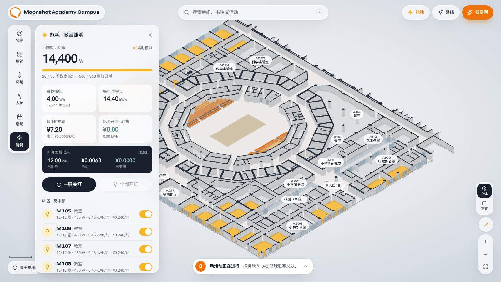
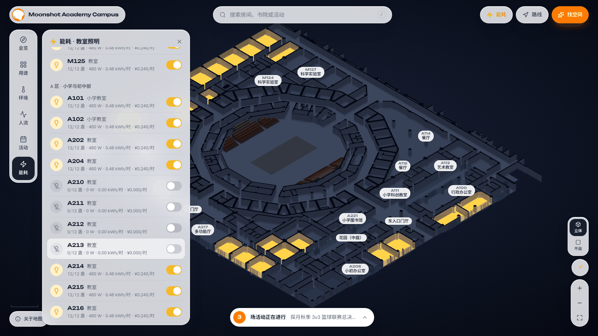
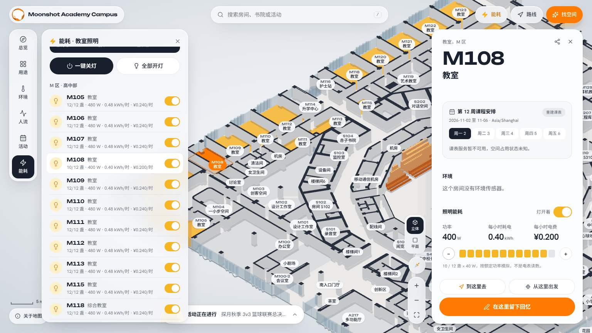

# Energy panel (能耗)

The energy panel shows how much electricity the classroom lighting uses, live, and lets you switch lights off to see the effect.

## Where to find it

- **Top bar → 能耗**, or **能耗** in the layer rail. Both open the panel and switch the map to the energy layer. Classrooms with all lamps on are warm yellow, partly lit ones pale yellow, and dark ones grey.
- **Room sheet → 照明能耗** (the 30 classrooms only). It shows power, kWh per hour and cost per hour. Turn the room off or on with the switch. Set the number of lamps with − / + or by tapping the 12 lamp cells.

## Night view

While the panel is open the map turns to night, so lit rooms stand out:
- The sky fill dims to moonlight, the sun almost goes out, and the background becomes a dark night sky.
- Wall sides lose their daytime glow.
- A lit classroom's floor glows warm, and its volume fills with soft additive light. Both scale with the share of lamps on, so a room at 6 / 12 glows half as bright and a room switched off goes dark.
- Everything eases over about half a second and returns to day when the panel closes. With reduced motion the change is instant.

## What the panel shows

| Figure | Meaning |
|---|---|
| 当前照明功率 | Lamps on × 40 W, over the 30 classrooms (full load 14,400 W) |
| 每秒耗电 | Energy used each second: power × 1 s, in Wh (also shown in joules) |
| 每小时耗电 / 每小时电费 | kWh per hour at the current power, × ¥0.5003/kWh |
| 比全开每小时省 | Saving against every lamp on |
| 打开面板以来 | Energy, cost and saving accumulated since the panel opened. It integrates the power as it changes and updates five times a second. |

Below these are 一键关灯 / 全部开灯 and every classroom, each with its lamps on, power, kWh per hour, cost per hour and a switch. Tapping a classroom opens its room sheet.

## Model and its limits

From the Lighting Audit Dataset:

| Input | Value | Evidence |
|---|---|---|
| Lamps per classroom | 12 (600 × 600 LED panels) | Site count in a representative classroom |
| Lamp power | 40 W | Rated power, confirmed by a teacher |
| Tariff | ¥0.5003 / kWh | Tariff used in earlier calculations; bill evidence still to be kept |
| Classrooms | 30: M 16, A 11, primary 2 (A101, A102), middle school 1 (A223) | Floor-plan count; configuration not checked room by room |

The 30 classrooms are those named 教室 / 综合教室 / 小学教室 / 初中教室 on FF-01 (`CLASSROOM_IDS` in `src/services/energyModel.ts`).

- **This is a simulation from rated power, not a meter reading.** The panel says so.
- **The switches do not control real lamps.** They are a what-if switchboard. It starts with every lamp on (the theoretical full load). Changes are kept in this browser (localStorage) and shared between its open tabs, not with other visitors.
- **The survey data is not built in.** The after-17:40 survey (which classrooms are empty but still lit, and for how long) is not in the model yet. When that data exists, it can set the starting state instead of "all on".

Code:
- `src/services/energyModel.ts`: constants, classroom list, figures, switchboard state, running meter.
- `src/components/ui/EnergyPanel.tsx`: the panel.
- The energy layer in `src/components/ui/mapLayers.ts`.
- The 照明能耗 section in `ContextDetailPanel.tsx`.
