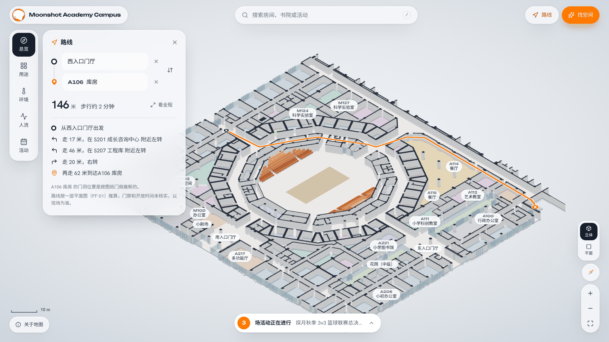
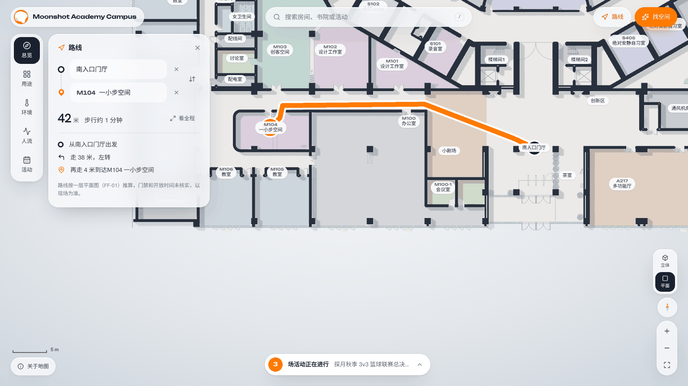
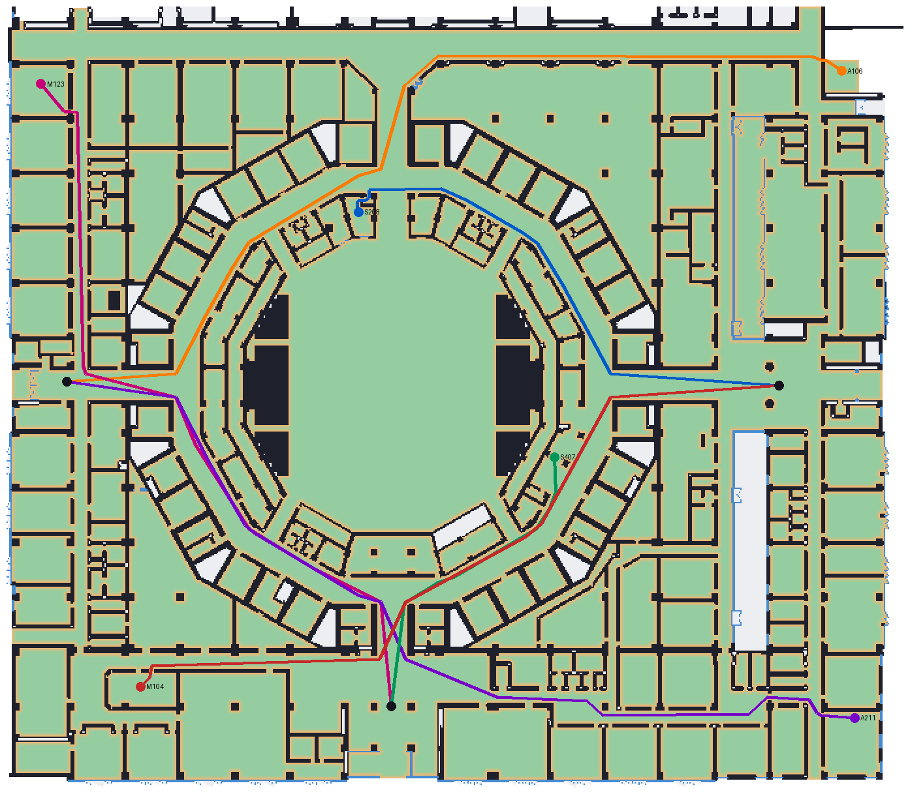

# Routes (路线)

Pick a start and a destination and the map draws the walking route, with distance, walking time and turn-by-turn directions.



## Using it

- **Top bar → 路线** opens the route panel. The start field opens first and offers 西门 / 东门 / 南门 as quick picks.
- **Room sheet → 到这里去 / 从这里出发** fills one end with that room and asks for the other.
- While a field is being picked, **clicking a room on the map** fills it instead of opening the room sheet. Each field also has its own search (room code, name or tag).
- The swap button exchanges start and end. 看全程 frames the whole route in the uncovered part of the map.
- The route is kept in the address bar (`/?from=ENTRANCE-WEST&to=A106`), so it can be shared. Opening that link opens the panel with the route.
- Esc first stops picking, then closes the panel.

The panel shows:
- distance and walking time (1.2 m/s);
- directions, where each bend over 35° is a left or right turn named after the nearest room within 7 m;
- when relevant, rooms the route has to pass through (for example M100-1 is reached through M100), and inferred door openings;
- a standing note that routes are computed from FF-01 and that doors, access control and opening hours are not verified.



## How routes are found

### 1. Walking grid (build time)

`scripts/build_nav_grid.py` → `src/generated/ff01-nav-grid.json` (260 KB, 46 KB gzipped; loaded the first time the panel opens).

| Step | Detail |
|---|---|
| Cells | 0.2 m, 697 × 609, over the model bounds |
| Blocked | Walls, glazing and arena stands from `ff01-campus-core.json`, plus everything outside the derived footprint |
| Walkable | At least 0.15 m from any blocked cell. The 3D walls are CAD lines thickened by 0.11 m per side, so door gaps in the model are narrower than real doors and a larger clearance would close them. |
| Cost | 1 in open corridor (≥ 0.7 m from walls), rising to 6 next to walls. This keeps routes centred in corridors. |
| Room index | The room each cell belongs to, plus the central court. Routes pay ×4 to cross a room other than their start and end (×2.5 for the court), so they keep to corridors. 小剧场 is open floor: it is closed only by a reviewer line. |
| Anchors | One cell per room: the reachable cell inside the room nearest its label. Label-only spaces (entrance halls, S407, 创新区, 茶室) use reachable cells within 3 m of the label. |

**Inferred door openings.** With walls alone, 9 rooms come out sealed: their door gap closed when the wall lines were thickened, though the door leaf and swing are drawn on FF-01. For each sealed room, the builder finds the shortest crossing to the main walkable area through non-walkable cells. The crossing must be at most 1.6 m and lie within 0.8 m of a line on the door layer, and walls far from a door are never crossed. Each crossing is recorded under `portals`, and the panel says when a route uses one.

| Room | Crossing |
|---|---|
| A106 库房 | 0.6 m |
| S204, S205, S206, S207 | 0.2 m each |
| S406 | 0.4 m |
| SVC-01 机房 | 0.4 m |
| SVC-05 清洁间, SVC-11 设备用房 | 0.2 m each |



*Green: walkable, darker near walls. Red: inferred door openings. Routes from the three entrances.*

### 2. Route search (browser)

`src/services/pathfinding.ts`:
1. **A\*** on the 8-connected grid. The octile heuristic is admissible because the minimum cell weight is 1. Diagonal moves may not squeeze past a wall corner. Each step costs its length × the mean weight of its two cells.
2. **Straightening.** Greedy string pulling replaces the grid staircase with straight segments. A shortcut is taken only if the straight line touches no blocked cell and no cell closer to a wall than the grid path already went.
3. **Directions** from the straightened polyline (`describeRoute`).

Across all 495 routes from the three entrances to every room: 0 failures, about 50 ms average, about 275 ms worst (Node, one core).

The route is drawn on the floor as an orange ribbon with a white casing (`src/components/canvas/routeLayer.ts`). It is drawn over walls so it stays readable in 2.5D.

## Rebuild and validate

```sh
npm run rebuild:campus-3d -- --pdf "/path/to/FF-01.pdf"   # if the model changed
npm run rebuild:nav-grid -- --preview /tmp/nav-grid.png    # optional PNG: grid, walls, inferred openings in red
npm run validate:nav-grid
```

The grid needs only the generated model JSON, not the PDF. `validate:nav-grid` checks:
- the grid was built from the current model;
- every room has an anchor on a walkable cell;
- all anchors are mutually reachable under the browser's movement rule;
- portal count (≤ 12) and crossing length;
- plausible walkable area.

## Limits

- **One floor.** FF-01 only. Stairs are drawn but not used, and there are no other floors to reach.
- **Doors are geometry, not access.** An opening in the wall model is treated as passable. Locked doors, staff-only areas, fire doors and opening hours are unknown.
- **Inferred openings** (table above) are positioned from the door layer, not surveyed.
- **No accessibility routing.** There is no step-free / wheelchair variant, and door widths in the model are not real widths.
- **Room shortcuts.** Inner rooms (M100-1, A115, several service rooms) are reached through their host room. The panel names those rooms.
- **Names** in the directions come from the FF-01 labels, which can differ from the 2026.8 guide map (for example S301 is 艺术库 on FF-01 and 会议室 on the guide map).
