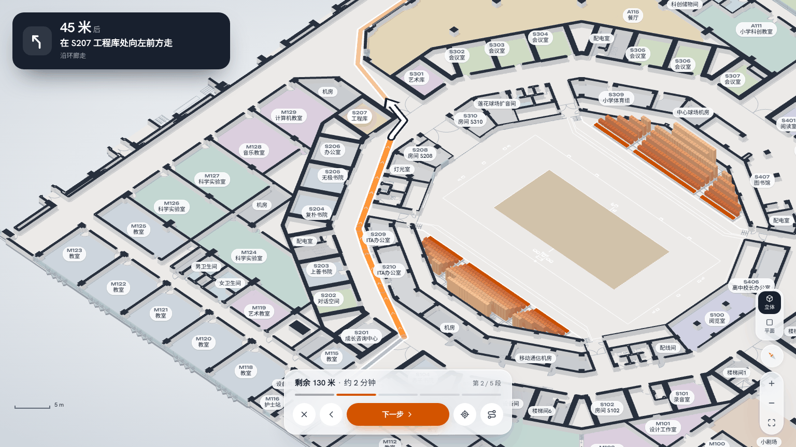
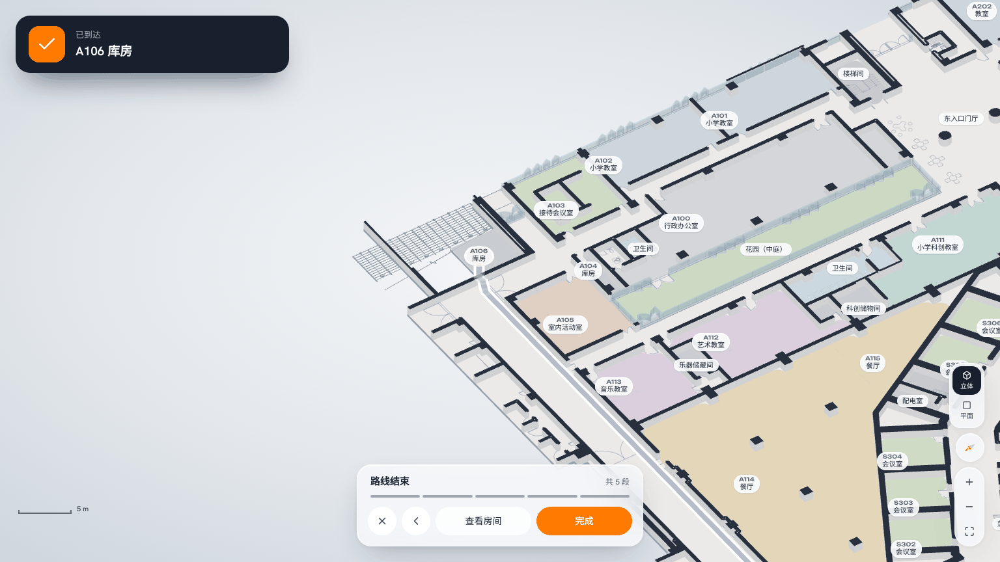

# Routes (路线)

Pick a start and a destination. The map draws the walking route, and 开始导航 walks you through it one step at a time.


## Step-by-step guidance (开始导航)

Modelled on the walking navigation in Apple Maps and Google Maps, and on the maneuver banner of navigation SDKs. There is no positioning indoors, so you advance the steps yourself.

| Part | What it does |
|---|---|
| Maneuver banner (top) | Shows the next maneuver: a turn glyph, the distance to it ("45 米后"), and the instruction with a landmark ("在 S207 工程库处向左前方走"). The first step also says where you set off and which way to head. When the turn after it comes within 18 m, a "然后右转" row previews it. |
| Map | Turns heading-up: the current leg points up the screen, tilted into 2.5D. The camera frames the leg plus 5 m past the turn. The walked part is grey, the current leg is bright orange with direction chevrons, and the rest is light orange. A white turn arrow with a dark outline marks the next maneuver. The landmark room is highlighted. |
| Bottom bar | Remaining distance and time, step x / n with a segmented progress bar, ✕ end, ‹ previous, 下一步 / 到达, back to this leg, and the whole route (toggle). |
| Arrival | 已到达 + the room. 查看房间 opens its sheet; 完成 returns to the overview. |
| Input | Swipe the banner left / right, or ← / → on a keyboard. Esc ends guidance. Tapping a step in the overview list starts guidance at that step. |

While guiding, the search bar, layer rail and the bottom capsule are hidden. On phones the map buttons are hidden too, so the map is not crowded.





### Wording

Each bend is measured on the straightened route. Bends on the same side less than 9 m apart are merged, because a 90° corner cut short becomes two 45° bends. A left-then-right jog under 3 m is dropped. The total angle gives the turn type:

| Angle | Wording |
|---|---|
| < 28° | not a turn |
| 28–60° | 向左前方走 / 向右前方走 |
| 60–135° | 左转 / 右转 |
| 135–165° | 向左后方转 / 向右后方转 |
| > 165° | 掉头 |

Other wording rules:
- The landmark is the nearest coded room within 7 m of the turn, excluding the start and end.
- 出门后左转 is used when the first turn is within 6 m of leaving a start room.
- 左转进入 M104 is used when the last turn is within 6 m of the destination.
- Legs that mostly follow the ring corridor around the arena (27–35.5 m from its centre) read 沿环廊走. The 45° bends at the corners of the octagonal ring are not announced as turns.
- Distances over 10 m are rounded to 5 m.

### Route drawing and walls (no more route through walls)

- **Lower walls.** In 2.5D, full-height 2.8 m walls hide most of a 2 m corridor floor, so a floor route looked like it ran through walls. While a route is on the map, walls and glazing animate down to 32 % of their height (about 0.9 m), the way indoor maps draw walls as low extrusions. They return to full height when the route closes.
- **Depth-tested route with an x-ray pass.** The route used to be drawn over everything. It is now depth-tested, so a wall in front hides it. A second, faint pass draws only the hidden parts (`depthFunc: GreaterDepth`), so the route can still be followed behind walls.
- **Maneuver arrow and markers** are drawn on top.

The guide map (探月学校导览图 2026.8) was used to check the corridor structure, the inner ring and the three gates.

## Using it

- **Top bar → 路线** opens the route panel. The start field opens first and offers 西门 / 东门 / 南门 as quick picks.
- **Room sheet → 到这里去 / 从这里出发** fills one end with that room and asks for the other.
- While a field is being picked, **clicking a room on the map** fills it instead of opening the room sheet. Each field also has its own search (room code, name or tag).
- The swap button exchanges start and end. 看全程 frames the whole route in the uncovered part of the map.
- The route is kept in the address bar (`/?from=ENTRANCE-WEST&to=A106`), so it can be shared. Opening that link opens the panel with the route.
- Esc first stops picking, then closes the panel.

The overview panel shows:
- walking time and distance (1.2 m/s);
- 开始导航;
- the list of steps (tap one to start guidance there);
- when relevant, rooms the route has to pass through (for example M100-1 is reached through M100), and inferred door openings;
- a standing note that routes are computed from FF-01 and that doors, access control and opening hours are not verified.

## How routes are found

### 1. Walking grid (build time)

`scripts/build_nav_grid.py` → `src/generated/ff01-nav-grid.json` (260 KB, 46 KB gzipped; loaded the first time the panel opens).

| Step | Detail |
|---|---|
| Cells | 0.2 m, 697 × 609, over the model bounds |
| Blocked | Walls, glazing and arena stands from `ff01-campus-core.json`, plus everything outside the derived footprint |
| Walkable | At least 0.15 m from any blocked cell. The 3D walls are CAD lines thickened by 0.11 m per side, so door gaps in the model are narrower than real doors and a larger clearance would close them. |
| Cost | 1 in open corridor (≥ 0.7 m from walls), rising to 6 next to walls. This keeps routes centred in corridors. |
| Room index | The room each cell belongs to, plus the central court. Routes pay ×4 to cross a room other than their start and end (×2.5 for the court), so they keep to corridors. 小剧场 is open floor: it is closed only by a reviewer line. |
| Anchors | One cell per room: the reachable cell inside the room nearest its label. Label-only spaces (entrance halls, S407, 创新区, 茶室) use reachable cells within 3 m of the label. |

**Inferred door openings.** With walls alone, 9 rooms come out sealed: their door gap closed when the wall lines were thickened, though the door leaf and swing are drawn on FF-01. For each sealed room, the builder finds the shortest crossing to the main walkable area through non-walkable cells. The crossing must be at most 1.6 m and lie within 0.8 m of a line on the door layer, and walls far from a door are never crossed. Each crossing is recorded under `portals`, and the panel says when a route uses one.

| Room | Crossing |
|---|---|
| A106 库房 | 0.6 m |
| S204, S205, S206, S207 | 0.2 m each |
| S406 | 0.4 m |
| SVC-01 机房 | 0.4 m |
| SVC-05 清洁间, SVC-11 设备用房 | 0.2 m each |


*Green: walkable, darker near walls. Red: inferred door openings. Routes from the three entrances.*

### 2. Route search (browser)

`src/services/pathfinding.ts`:
1. **A\*** on the 8-connected grid. The octile heuristic is admissible because the minimum cell weight is 1. Diagonal moves may not squeeze past a wall corner. Each step costs its length × the mean weight of its two cells.
2. **Straightening.** Greedy string pulling replaces the grid staircase with straight segments. A shortcut is taken only if the straight line touches no blocked cell and no cell closer to a wall than the grid path already went.
3. **Steps** from the straightened polyline (`describeRoute`). The wording is in `src/components/ui/routeText.ts`.

Across all 495 routes from the three entrances to every room: 0 failures, about 50 ms average, about 275 ms worst (Node, one core).

The route is drawn by `src/components/canvas/routeLayer.ts`, and guidance by `src/components/ui/RouteGuidance.tsx`. Heading-up framing uses `CampusCameraController.framePoints`.

## Rebuild and validate

```sh
npm run rebuild:campus-3d -- --pdf "/path/to/FF-01.pdf"   # if the model changed
npm run rebuild:nav-grid -- --preview /tmp/nav-grid.png    # optional PNG: grid, walls, inferred openings in red
npm run validate:nav-grid
```

The grid needs only the generated model JSON, not the PDF. `validate:nav-grid` checks:
- the grid was built from the current model;
- every room has an anchor on a walkable cell;
- all anchors are mutually reachable under the browser's movement rule;
- portal count (≤ 12) and crossing length;
- plausible walkable area.

## Limits

- **One floor.** FF-01 only. Stairs are drawn but not used, and there are no other floors to reach.
- **Doors are geometry, not access.** An opening in the wall model is treated as passable. Locked doors, staff-only areas, fire doors and opening hours are unknown.
- **Inferred openings** (table above) are positioned from the door layer, not surveyed.
- **No accessibility routing.** There is no step-free / wheelchair variant, and door widths in the model are not real widths.
- **Room shortcuts.** Inner rooms (M100-1, A115, several service rooms) are reached through their host room. The panel names those rooms.
- **Names** in the directions come from the FF-01 labels, which can differ from the 2026.8 guide map (for example S301 is 艺术库 on FF-01 and 会议室 on the guide map).
